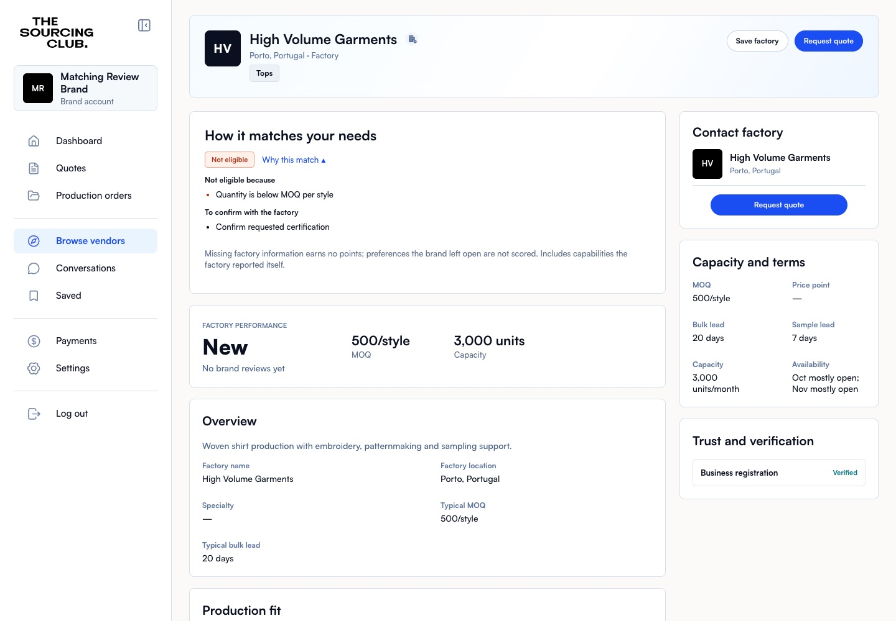

# Factory matching v2

Matching is deterministic SQL. Company verification and credits remain separate from match eligibility, profile completeness and supporting-evidence approval.

## Rollout and rollback

The additive migration creates `matching_settings` with `enabled=false`. While disabled, the UI hides the new panels and existing numeric score RPCs use their original implementations. No existing profiles are rewritten. Existing orders, quoting permissions and verification grants are unchanged.

PR previews share the qa database (Supabase branching is off). To test there, apply the migration to qa, run the seed with `--remote` (it turns the flag on), or enable it with a trusted SQL/service-role connection:

```sql
update public.matching_settings set enabled=true where id;
```

The flag is global to a database: while it is on in qa, every preview's invitations to a factory that is not fully qualified need the acknowledgement this branch adds, and older code has none, so turn it off when testing is done. Production enablement is a separate release decision after migration checks, preview acceptance and review of existing test failures. Roll back behavior with `enabled=false`, then refresh the client; do not delete the additive data or revert migrations. Evidence write protections remain active to prevent self-approval and stale approvals even when matching is disabled.

## Decisions made in review

- **Every staff decision tells the factory.** Rejecting or asking for more information needs a note, enforced in the database and in the UI (the buttons stay disabled without one). The factory gets a bell notice with the note and reads it on its profile ("Note from TSC"); staff see the note they sent.
- **A certificate's facility name never excludes** (see the certification rule below). It is free text, so an exact-match rule excluded factories whose certificate names a unit or adds "Lda.", even after staff approved it.
- **The matching panels are hand-built**, because no design draws them. They follow `TSC_DESIGN_SYSTEM.md` ("Matching explanations and evidence") and stay behind the flag, and CLAUDE.md lists them as held back until a design exists. Queena's screens only gain one optional slot prop or line each; the prototypes pass none of them.

## Interfaces and interpretation

- `factory_match_v2(subject_type, subject_id, factory_org)` returns `version`, `status` (`qualified`, `needs_confirmation`, `excluded`), percentage `score`, evidence/data `coverage`, factor contributions, missing/failed reasons, capability evidence status and the estimated-timeline marker.
- `factory_matches_v2(subject_type, subject_id, factory_orgs)` batches at most 100 factories. Clients chunk larger directories. Reads remain subject to RLS; another brand’s private preferences or inaccessible RFQ return no assessment.
- `save_matching_profile(subject_type, subject_id, selections, details)` saves only matching groups atomically. Existing unrelated taxonomy groups remain untouched. Legacy profile selections are preserved and are not guessed into the new fabric/technique/service vocabulary.
- `review_matching_evidence(evidence_type, evidence_id, decision, note)` is staff-only (`is_platform_admin()` is its first statement). `rejected` and `pending` ("Ask for more information") refuse an empty note. Certificate metadata must include validity, named facility, country and applicable scope before approval. Every decision writes one history row and a bell notification to the factory (`matching_evidence_approved`, `matching_evidence_rejected`, `matching_evidence_needs_information`; subject `org`, so it opens `/profile`; no email category). Company verification and credit ledger entries are never changed by this RPC. The legacy document-review function also receives a qualified-column fix for its pre-existing ambiguous certificate join.
- `matching_evidence_notes(target_org)` returns staff's latest decision and note per evidence item, to members of that company and to staff only. Brands never see `review_note` or `matching_evidence_history`. A newer row written by the factory (a replaced file) hides the old note, because the review it answered no longer applies.
- Existing `match_score` and `match_score_rfq` signatures and 0–1 scale remain available. When enabled, ineligible matches return null. The brand-profile wrapper reads saved matching quantities/deadlines; the legacy quantity/month arguments apply only while the flag is off.
- Required category, MOQ, deadline, certification and location failures exclude matching recommendations/invitation candidates. Unknowns remain provisional. Directory search retains the current main restriction to verified, non-demo published profiles, including explanations for an unsuitable match. Dashboard recommendations use the same verified/non-demo restriction.
- Invitation inserts/identity changes are reassessed in SQL. `matching_acknowledged=true` is required for provisional invitations and cannot override an exclusion. Existing invitations are not removed when a profile changes.
- RFQ automatic matching notifications require a qualified assessment while v2 is enabled. Provisional and excluded factories do not receive strong-match recommendations.

With deadlines the weights are 30/25/15/15/10/5; without deadlines they are 35/30/20/0/10/5, for product/order size/development/timeline/region/certifications respectively. Unspecified brand factors are omitted and weights renormalised. Missing factory data earns zero within applicable factors. Coverage measures known data, including labelled self-reported claims; it is not a staff verification percentage.

Product category, fabric and technique coverage are averaged equally across specified groups. Order fit averages MOQ compliance and the ratio to the nearest usual-order-range boundary (full points within range). Development support measures requested services, never the number of unrelated offerings. Preferred countries earn full credit; explicitly accepted alternatives earn half. Certification credit requires relevant staff-reviewed, current evidence covering the selected products/materials. A required certificate excludes a factory, with one named reason each, when it was rejected, expires before the order is due, is for a facility in another country, or its scope misses the request's product or fabric (for example "GOTS certificate does not cover this product or fabric"). The free-text facility name never excludes: on an unreviewed certificate a mismatch with the company's name asks "Confirm the facility named on the certificate"; an approved certificate is trusted because staff checked it.

Timeline estimates combine sample/bulk lead times and conservatively available capacity. A delivered date needs a shipping allowance; missing or approximate legacy dates need confirmation. Sample-month and production-month availability are checked when different. These estimates are not reservations or delivery guarantees. Each RFQ is one style with multiple colours.

## Verification record

On a local stack with this branch's migrations, and on the shared qa database behind the PR preview.

- `supabase/tests/explainable_matching_test.sql`: **89 assertions pass**. They cover exact weights, partial information, MOQ per colour, usual order ranges, delivered/sample deadlines, full capacity, certificate scope/expiry/country, the facility-name rule, staff-only approval, required notes, notifications and notes access, single history rows, approval invalidation, storage replacement versus metadata updates, evidence deleted with its file, deleting a factory with evidence, atomic profile saves, rejection of unknown or foreign terms in every validation, invitation acknowledgement, batch limits and flag-off compatibility.
- Full `db:test`: 1,023 assertions. The 12 failures are the same set that fails on `main` (admin access 10/12/13, legal documents 6/7/11, message access 13/14, order access 17/18, order interior 19/22); none come from this change.
- `smoke`: the same 286 passes and 4 failures as `main`. `e2e`: 233 checks, then `main`'s known stop at Conversations. `check:css`, `check:prototype` and `build` pass.
- In the browser, with the flag on, each surface below was used as factory, staff and brand, at 375px, and again with the flag off, when no matching UI renders.

Brand: Browse ranks and explains. Each card has a status pill in the fit tiers and a "Why this match" disclosure, reasons first.


Brand: a vendor page that does not meet the must-haves, and why.



Brand: the invite step. Each invite card carries its explanation, and a factory that is not fully qualified needs the acknowledgement by the invite button.


Factory: supporting evidence with a note from TSC, one item waiting, and an approved certificate with its details.


Staff: the evidence panel under the Verification queue. Reject and Ask for more information need a note; the certificate's facility, country, validity and scope sit beside the decision.


## Reproduce

**Fixtures.** The seed creates a brand, three factories (qualified, provisional, excluded), staff and a draft request, all signing in with the demo password (CLAUDE.md, "Demo data"), and turns the flag on for that database only.

```sh
# a local stack
MATCHING_SUPABASE_WORKDIR=$PWD node scripts/seed-matching-review.mjs
# a test database, such as qa; refuses the production project
SUPABASE_URL=… SUPABASE_SERVICE_KEY=… node scripts/seed-matching-review.mjs --remote
```

It prints the `VITE_SUPABASE_*` lines a dev server needs instead of writing `.env.local`. Logins: `matching-review-brand@example.com`, `matching-review-qualified@example.com` (factory) and `matching-review-staff@example.com`.

**The screenshots** come from `scripts/capture-matching-evidence.mjs`, run against a dev server after the seed and this state, which gives Lusitania a complete GOTS certificate and two pieces of evidence, makes GOTS a must-have for the brand, and has staff decide two items through the real function:

```sql
\set F 'e9800000-0000-0000-0000-000000000002'
insert into taxonomy_links(subject_type,subject_id,org_id,term_id) select 'factory_profile',:'F',:'F',id from taxonomy_terms where kind='fabric' and label_en='Denim' and org_id is null on conflict do nothing;
with doc as (insert into documents(org_id,kind,bucket,storage_path,file_name) values(:'F','certificate','org-private',:'F'||'/certificate/gots.pdf','gots.pdf') returning id)
insert into factory_certifications(org_id,term_id,document_id,expires_at,facility_country,facility_name,scope_all_products)
select :'F',(select id from taxonomy_terms where kind='certification' and label_en='GOTS' and org_id is null),doc.id,current_date+400,'PT','Lusitania Shirts',true from doc;
with doc as (insert into documents(org_id,kind,bucket,storage_path,file_name) values(:'F','capability_evidence','org-private',:'F'||'/capability_evidence/embroidery.pdf','embroidery.pdf') returning id)
insert into factory_capability_evidence(org_id,term_id,document_id) select :'F',(select id from taxonomy_terms where kind='technique' and label_en='Embroidery' and org_id is null),doc.id from doc;
with doc as (insert into documents(org_id,kind,bucket,storage_path,file_name) values(:'F','capability_evidence','org-private',:'F'||'/capability_evidence/denim.pdf','denim-tests.pdf') returning id)
insert into factory_capability_evidence(org_id,term_id,document_id) select :'F',(select id from taxonomy_terms where kind='fabric' and label_en='Denim' and org_id is null),doc.id from doc;
insert into taxonomy_links(subject_type,subject_id,org_id,term_id) select 'brand_profile','e9800000-0000-0000-0000-000000000001','e9800000-0000-0000-0000-000000000001',id from taxonomy_terms where kind='certification' and label_en='GOTS' and org_id is null on conflict do nothing;
update matching_requirements set required_term_ids=array[(select id from taxonomy_terms where kind='certification' and label_en='GOTS' and org_id is null)] where subject_type='brand_profile' and subject_id='e9800000-0000-0000-0000-000000000001';
begin;
select set_config('request.jwt.claims',(select json_build_object('sub',id,'role','authenticated')::text from auth.users where email='matching-review-staff@example.com'),true);
set local role authenticated;
select review_matching_evidence('certificate',(select id from factory_certifications where org_id=:'F'),'verified');
select review_matching_evidence('capability',(select e.id from factory_capability_evidence e join taxonomy_terms t on t.id=e.term_id where e.org_id=:'F' and t.label_en='Embroidery'),'pending','Please add close-up photos of the embroidery stitching.');
commit;
```

```sh
E2E_URL=http://127.0.0.1:5173 node scripts/capture-matching-evidence.mjs
```

Run the legacy regression suites with the flag off; the matching suite controls its own flag inside a rollback-only transaction.
