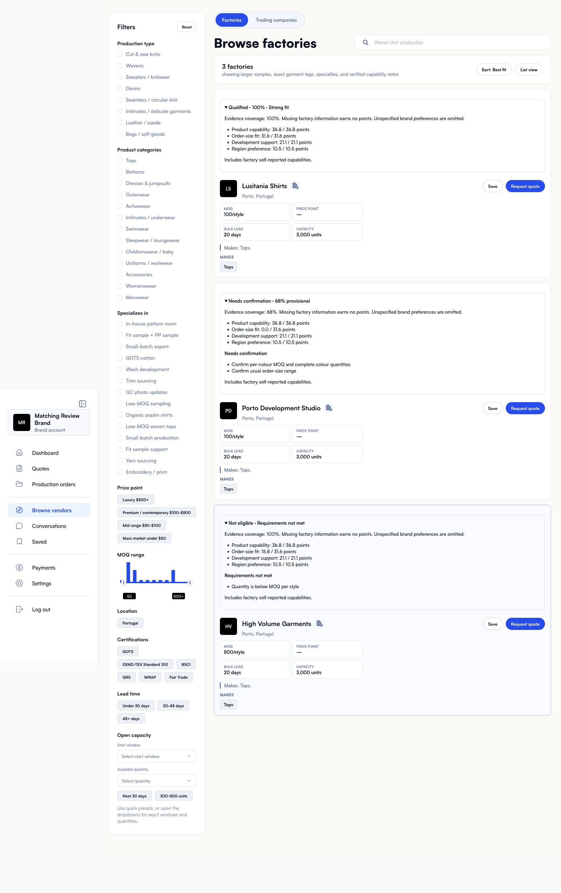
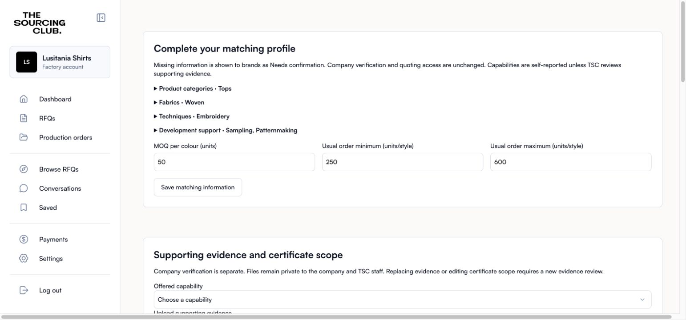
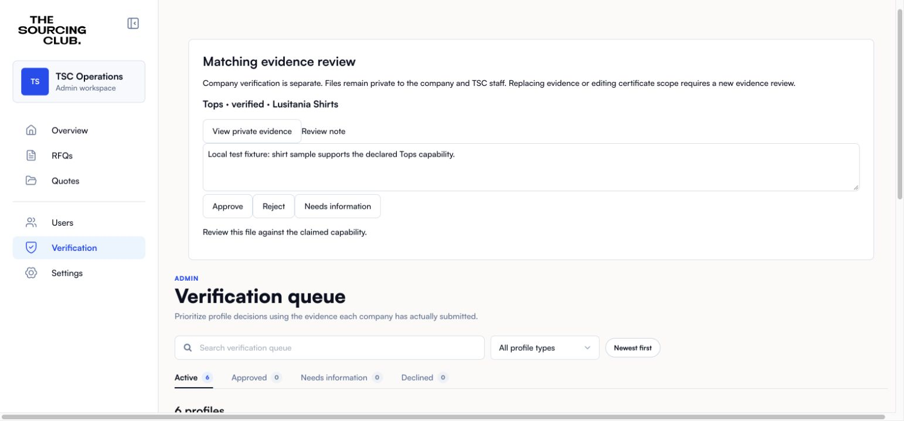
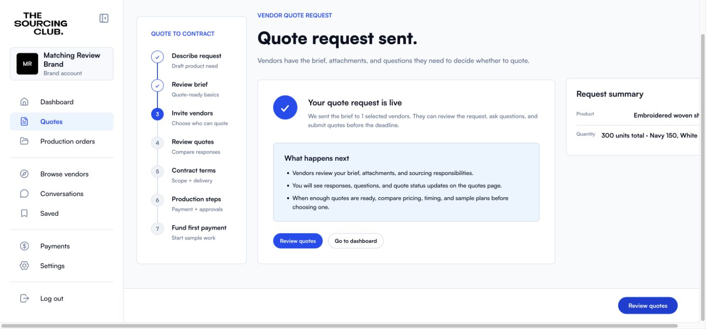

# Factory matching v2

Matching is deterministic SQL. Company verification and credits remain separate from match eligibility, profile completeness and supporting-evidence approval.

## Rollout and rollback

The additive migration creates `matching_settings` with `enabled=false`. While disabled, the UI hides the new panels and existing numeric score RPCs use their original implementations. No existing profiles are rewritten. Existing orders, quoting permissions and verification grants are unchanged.

After applying the migration to an isolated preview database, validate the scenarios below. Enable only that preview using a trusted SQL/service-role connection:

```sql
update public.matching_settings set enabled=true where id;
```

Production enablement is a separate release decision after migration checks, preview acceptance and review of existing test failures. Roll back behavior with `enabled=false`, then refresh the client; do not delete the additive data or revert migrations. Evidence write protections remain active to prevent self-approval and stale approvals even when matching is disabled.

## Interfaces and interpretation

- `factory_match_v2(subject_type, subject_id, factory_org)` returns `version`, `status` (`qualified`, `needs_confirmation`, `excluded`), percentage `score`, evidence/data `coverage`, factor contributions, missing/failed reasons, capability evidence status and the estimated-timeline marker.
- `factory_matches_v2(subject_type, subject_id, factory_orgs)` batches at most 100 factories. Clients chunk larger directories. Reads remain subject to RLS; another brand’s private preferences or inaccessible RFQ return no assessment.
- `save_matching_profile(subject_type, subject_id, selections, details)` saves only matching groups atomically. Existing unrelated taxonomy groups remain untouched. Legacy profile selections are preserved and are not guessed into the new fabric/technique/service vocabulary.
- `review_matching_evidence(evidence_type, evidence_id, decision, note)` is staff-only. Certificate metadata must include validity, named facility, country and applicable scope before approval. Company verification and credit ledger entries are never changed by this RPC.
- Existing `match_score` and `match_score_rfq` signatures and 0–1 scale remain available. When enabled, ineligible matches return null. The brand-profile wrapper reads saved matching quantities/deadlines; the legacy quantity/month arguments apply only while the flag is off.
- Required category, MOQ, deadline, certification and location failures exclude matching recommendations/invitation candidates. Unknowns remain provisional. Directory search continues to show published profiles, including explanations for an unsuitable match.
- Invitation inserts/identity changes are reassessed in SQL. `matching_acknowledged=true` is required for provisional invitations and cannot override an exclusion. Existing invitations are not removed when a profile changes.
- RFQ automatic matching notifications require a qualified assessment while v2 is enabled. Provisional and excluded factories do not receive strong-match recommendations.

With deadlines the weights are 30/25/15/15/10/5; without deadlines they are 35/30/20/0/10/5, for product/order size/development/timeline/region/certifications respectively. Unspecified brand factors are omitted and weights renormalised. Missing factory data earns zero within applicable factors. Coverage measures known data, including labelled self-reported claims; it is not a staff verification percentage.

Product category, fabric and technique coverage are averaged equally across specified groups. Order fit averages MOQ compliance and the ratio to the nearest usual-order-range boundary (full points within range). Development support measures requested services, never the number of unrelated offerings. Preferred countries earn full credit; explicitly accepted alternatives earn half. Certification credit requires relevant staff-reviewed, current evidence covering the named facility and selected products/materials. A certificate expiring before the requested deadline fails a mandatory requirement.

Timeline estimates combine sample/bulk lead times and conservatively available capacity. A delivered date needs a shipping allowance; missing or approximate legacy dates need confirmation. Sample-month and production-month availability are checked when different. These estimates are not reservations or delivery guarantees. Each RFQ is one style with multiple colours.

## Verification record

Local stack: isolated `TSCMatchingReview`, API port 55321. No production data is seeded or reset.

- Clean migration application succeeds.
- 68 new pgTAP assertions pass, including exact weights, partial information, MOQ per colour, usual order ranges, delivered/sample deadlines, full capacity, certificate scope/expiry/facility, staff-only approval, approval invalidation, storage replacement, private document access, atomic profile saves, invitation acknowledgement, batch limits and flag-off compatibility.
- `npm run build` and `npm run check:prototype` pass.
- Full database suite: 977 assertions; the same 12 pre-existing failures remain in admin access (10,12,13), legal documents (6,7,11), message access (13,14), order access (17,18), and order interior (19,22). These are not represented as passing. The previously captured clean-main result contains the same failure set.
- Browser: authenticated brand directory shows a qualified 100% match, a 68% provisional match with missing MOQ/range information, and a factory excluded for per-style MOQ. The deadline-specific RFQ changes the provisional percentage to 74%, keeps the qualified factory at 100%, and excludes the unsuitable invitation candidate. Native date inputs save and resume. Inviting a provisional factory is blocked until acknowledgement; the successful local invitation persists `matching_acknowledged=true`.



Factory order-size changes persist after reload. A real authenticated local upload stores capability evidence in `org-private`; staff approval changes only the evidence status, leaving company verification and credits unchanged. Chrome file-picker automation was blocked by the extension’s file-URL permission, so the upload itself was exercised through the authenticated Storage/Data API.







## Reproduce local review fixtures

Start an isolated local Supabase project with this branch’s migrations and use its workdir explicitly:

```sh
MATCHING_SUPABASE_WORKDIR=/path/to/isolated/project node scripts/seed-matching-review.mjs
npm run dev -- --port 5176
```

The seed script refuses hosted URLs, creates only named local fixtures, writes local publishable connection settings to ignored `.env.local`, and enables matching only on that local stack. It outputs a short-lived code for the local review brand; fresh email codes work with the local mail catcher. Run the legacy regression suite with the runtime flag off; the new suite controls its own flag in a rollback-only transaction.
